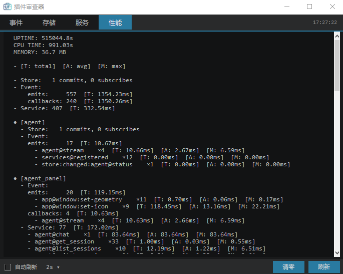
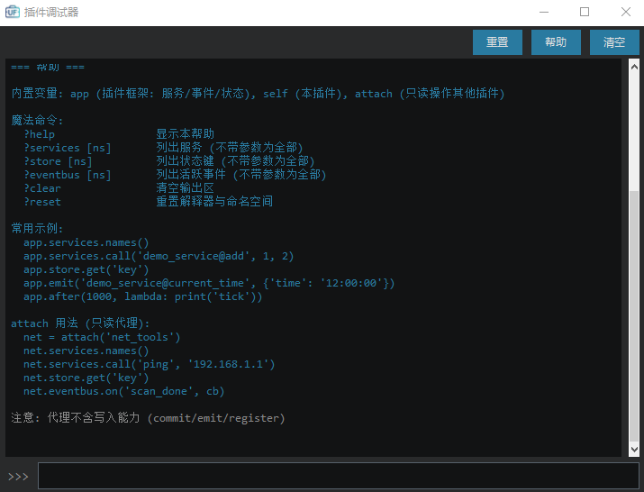
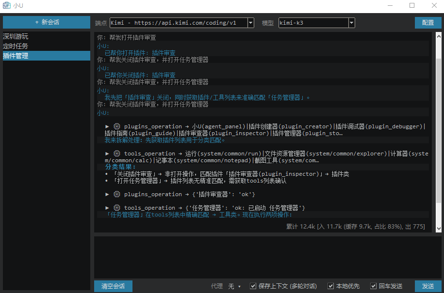
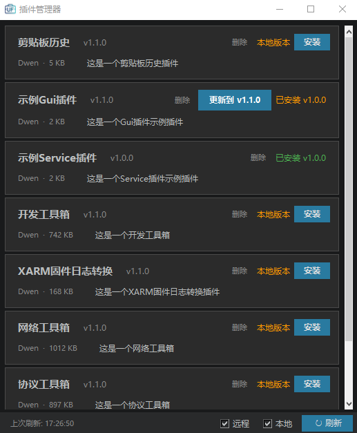
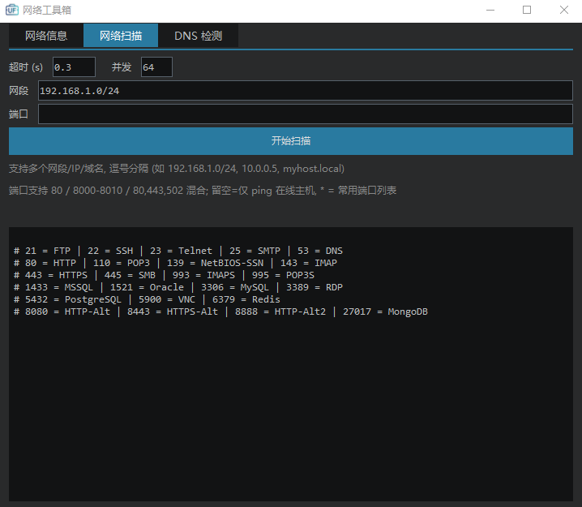
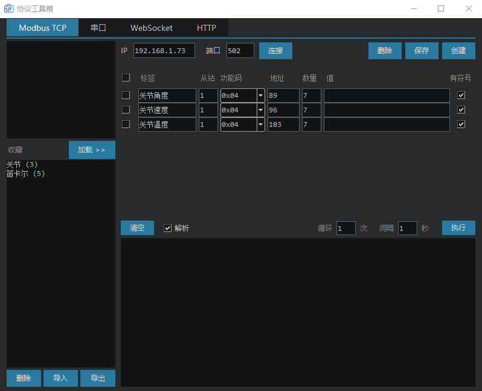
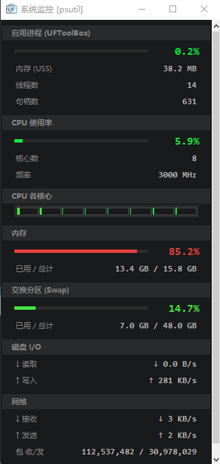

# UF 工具箱（UF Toolbox）

UF 桌面效率工具箱。以一条常驻屏幕顶部的导航栏为主界面，集中提供系统/自定义程序快捷启动、插件化能力扩展，以及 AI 助手、任务调度、通知、插件商店等内置功能。

- **轻量**：纯 Python + Tkinter，无第三方运行时依赖
- **常驻**：无边框导航栏，支持窗口置顶与贴顶自动收缩
- **可扩展**：GUI / Service 双类型插件，自动发现、惰性加载、热重载
- **开箱即用**：内置小U AI 助手、任务调度器、通知服务、插件管理器

## 快速开始

### 环境要求

- Python >= 3.10
- Tkinter（Windows/macOS 的 Python 安装包自带；Linux 需安装 `python3-tk`）
- 可选：Pillow（仅作为图标加载失败时的回退）
- 支持 Windows 与 Linux 桌面环境；部分能力（如「管理员运行」、控制台窗口控制）仅 Windows 可用

### 安装

```bash
conda create -n uf-toolbox python=3.10 -y
conda activate uf-toolbox
pip install -e ".[dev]"
```

### 运行

```bash
uf-toolbox
# 或
python uf_toolbox.py
```

程序带单实例守卫：已在运行时再次启动会提示并退出。

---

## 界面与使用

### 导航栏

主窗口是一条无边框、可拖动的导航栏，默认排列为：

| 菜单 | 内容 |
|------|------|
| **设置** | 外观（浅色/深色）、语言（中文/English/自动）、窗口置顶、自动收缩、配置、日志、关于 |
| **系统** | 系统类工具，按 `tools.json` 中 `system/` 前缀分组 |
| **工具** | 通用工具，自动扫描工具目录及 `tools.json` 配置 |
| **插件** | 已发现的插件列表，点击启动；运行中的插件显示 ●，可显示/隐藏/销毁或停止 |
| **✕** | 退出程序 |

其他行为：

- **窗口置顶**：开关后主窗口始终位于其他窗口之上。
- **自动收缩**：主窗口贴靠屏幕顶部时，一段时间无操作后收缩为一条 3px 橙色细线；鼠标移入立即恢复。
- **主题/语言**：切换即时生效，并同步应用到所有已打开的窗口（设置、日志、插件窗口等）。

### 配置窗口（设置 → 配置）

| 配置项 | 说明 |
|--------|------|
| **工具路径** | 外部工具扫描目录，默认为程序所在目录下的 `tools/`（开发运行时为 `dist/tools/`，不存在时仅使用内置工具） |
| **插件路径** | 第三方插件加载目录，默认为程序所在目录下的 `plugins/`（开发运行时优先 `dist/plugins/`，否则回退到 `~/.uf_toolbox/plugins`） |
| **插件仓库地址** | 插件商店索引地址，留空时使用内置默认地址 |

- 内容有改动时「保存」按钮才可点击；关闭窗口时若有未保存修改会弹窗询问。
- 配置持久化到 `~/.uf_toolbox/config.json`。

### 日志窗口（设置 → 日志）

实时捕获并显示程序的标准输出/错误输出与日志，最多保留最近 2000 行，支持一键清空。

---

## 工具系统

工具菜单由 **内置配置 + 外部目录** 共同组成：

1. 始终扫描内置的 `tools/tools.json`；非 Windows 平台存在 `tools/tools_linux.json` 时优先使用它。
2. 若配置了外部工具路径，再扫描该目录。多个目录按顺序合并，**相同完整 ID 的工具由后扫描到的覆盖**。
3. 目录下没有 `tools.json` 时，自动扫描可执行文件（Windows：`.exe/.bat/.cmd`；其他平台：无扩展名/`.sh/.py`）。

### 菜单归属

工具 ID 的前缀决定菜单归属：

| ID 示例 | 归属 |
|---------|------|
| `vscode` | 工具菜单 |
| `system/mytool` | 系统菜单 |
| `system/common/notepad` | 系统菜单 → 常用 |

没有 `/` 的 ID 默认归入工具菜单。

### 常用参数

| 参数 | 说明 |
|------|------|
| `id` / `name` / `path` | 唯一标识、显示名、可执行文件路径（必填） |
| `name_zh` / `name_en` | 中英文显示名 |
| `args` | 命令行参数 |
| `shell` / `console` | 是否经 shell 启动 / 是否显示控制台窗口 |
| `cwd` / `env` | 工作目录 / 环境变量 |
| `multiple` / `wait` / `kill_on_exit` | 是否允许多实例 / 等待退出 / 随主程序关闭 |
| `privilege_level` | `user`（默认）、`admin` 或 `both`（`both` 显示「运行 / 管理员运行」子菜单） |
| `ignore` | 跳过该项 |

详细的配置格式、分组、覆盖与示例见 [工具配置指南](docs/tool-guide-zh.md)。

---

## 插件系统

### 插件类型

| 类型 | 基类 | 说明 |
|------|------|------|
| **GUI 插件** | `GuiPlugin` | 插件实例本身就是一个窗口，适合带界面的功能 |
| **Service 插件** | `ServicePlugin` | 无窗口后台服务，通过 services 向其他插件提供函数调用 |

插件放在插件目录下，每个插件一个包：

```
plugins/
  my_plugin/
    __init__.py      # from .my_plugin import MyPlugin
    my_plugin.py     # 插件实现
```

### 加载机制

- 程序启动或刷新插件列表时自动发现插件；元数据（名称、命名空间、优先级等）通过 AST 扫描读取，**不执行插件代码**。
- 首次启动某插件时才导入其模块（惰性加载），菜单点击保持轻量。
- 监视插件包内 `.py` 文件的修改时间，源码变化后下次启动会重新导入（热重载）。
- 每个插件拥有独立命名空间；插件停止时，框架自动清理该命名空间下的事件监听、Store 键值与 services。
- 支持 `priority`（菜单排序）、`auto_start`（随程序自启）、`start_hidden`、`reload`、`fixed_position`、`fixed_size`、`use_app_icon` 等元数据。

插件开发方式、生命周期钩子与完整模板见 [插件开发指南](docs/plugin-guide-zh.md)。

### 内置插件

| 插件 | 命名空间 | 说明 |
|------|----------|------|
| **小U** | `agent_panel` | AI 对话面板，支持流式输出、多轮会话、工具调用 |
| **插件管理器** | `plugin_store` | 插件商店：浏览、安装、更新、删除远程/本地插件 |
| **任务调度器** | `task_panel` | 定时任务管理面板（依赖内置 `tasks` 服务） |
| **插件创建器** | `plugin_creator` | 通过表单向导生成 GUI / Service 插件模板 |
| **插件调试器** | `plugin_debugger` | 带 `app` / `self` / `attach` 的交互式 REPL |
| **插件审查器** | `plugin_inspector` | 实时查看事件、Store、服务与性能统计 |
| **插件指南** | `plugin_guide` | 渲染插件开发文档（也用于工具指南窗口） |

**界面预览**：

| 插件审查器 | 插件调试器 |
|:---:|:---:|
|  |  |

### 内置后台服务

以下服务不显示在插件菜单中，随程序自动启动：

| 服务 | 命名空间 | 说明 |
|------|----------|------|
| `AgentService` | `agent` | 小U 的后端：模型请求、流式事件、工具执行、会话管理 |
| `TasksService` | `tasks` | 任务调度引擎 |
| `NotifyService` | `notify` | 通知弹窗服务 |

### 插件间通信

插件通过 `self.app` 访问三个共享组件，所有名称统一为 `命名空间@名称`，短名会自动加上当前命名空间前缀：

| 组件 | 用途 | 示例 |
|------|------|------|
| **EventBus** | 发布/订阅事件 | `self.app.on(...)` / `self.app.emit(...)` |
| **Store** | 命名空间隔离的共享键值状态 | `self.app.store.commit(...)` / `subscribe(...)` |
| **Services** | 跨插件函数调用 | `self.app.services.register(...)` / `call(...)` |

插件生命周期事件（`plugins@hook:will-start` / `did-start` / `will-show` / `did-destroy` 等）可用于感知其他插件状态。详见 [插件开发指南](docs/plugin-guide-zh.md)。

---

## 内置功能详解

### 小U（AI 助手）

基于 **OpenAI 兼容 API** 的工具调用 Agent，UI 与服务完全解耦。

**配置**：`~/.uf_toolbox/agent/agent_config.json`

- 支持任意 OpenAI 兼容端点；内置 DeepSeek、OpenAI、Moonshot、Kimi、GLM、Gemini、Grok 等预设。
- API Key 支持多层匹配：配置文件显式 Key → 当前端点配置 → 环境变量（如 `DEEPSEEK_API_KEY`）/ Claude Code / Codex 配置自动匹配。
- 默认 socket 读超时 180 秒，适配推理模型的长时间思考。
- 面板内可直接切换端点与模型，修改即时生效；「配置」按钮打开端点管理窗口。

**对话面板**：

- 流式输出，100ms 攒批 + Markdown 分段渲染。
- Ctrl+Enter 发送；勾选「回车发送」后 Enter 直发（Shift+Enter 换行）；↑/↓ 翻阅输入历史（最多 50 条）。
- **多会话管理**：左侧会话侧栏支持新建、切换、双击重命名、右键删除；会话按最后消息时间倒序排列，首次提问自动生成标题。
- 会话以 sqlite 持久化到 `~/.uf_toolbox/agent/agent_sessions.db`，重启不丢失；数据库保留全量消息，发送给模型的上下文为最近 24 条。
- 多轮上下文默认开启，可关闭「保存上下文」进行单轮问答（不读不写历史）。
- 可勾选「优先本地匹配」，优先使用零 token 的本地意图/问答。
- 显示当前会话累计 token 用量（输入、输出、缓存命中）。
- 工具调用以折叠行展示，点击展开完整结果；危险工具执行前会弹窗确认。



**内置能力**：

- 本地意图识别：如「打开/关闭 X」直接执行对应工具，不消耗 token。
- 内置基础问答：自我介绍等常见问题离线应答。
- 内置网关工具：`tools_operation`（启动外部工具）、`plugins_operation`（管理插件）、`tasks_operation`（管理定时任务）、`notify_operation`（发送通知）。
- 插件可通过类属性 `agent_tools` 声明式贡献能力，也可在运行时注册。
- 工具调用轮数上限 10，防止模型死循环。

设计与扩展方法见 [Agent 助手设计文档](docs/agent-assistant-zh.md)。

### 任务调度器

内置任务引擎 + GUI 管理面板，任务持久化到 `~/.uf_toolbox/tasks.json`，重启自动恢复。

| 类型 | 说明 | 示例 |
|------|------|------|
| `every` | 每隔 N 秒执行 | `tasks@create_every('ping', 30, 'demo@hello')` |
| `once` | 延迟/指定时刻执行一次 | `tasks@create_once('job', '09:00', 'demo@report')` |
| `daily` | 每天指定时刻执行 | `tasks@create_daily('cleanup', '03:00', 'demo@clean')` |
| `weekly` | 每周指定几天执行 | `tasks@create_weekly('report', [0,2,4], '09:00', 'demo@report')` |
| `cron` | 五段式 Cron 表达式 | `tasks@create_cron('heartbeat', '*/5 * * * *', 'demo@ping')` |

- 目标格式为 `namespace@method`，支持逗号分隔多个目标。
- 支持暂停/恢复/重启/删除、全部暂停/恢复、导入/导出 JSON。
- 任务状态分组：活跃 → 失败 → 停用 → 完成；失败任务自动暂停。
- 目标插件离线时自动后台启动后重试；执行历史保留最近 10 次。
- 完整参数与用法见 [任务调度器说明](docs/task-scheduler-zh.md)。

### 通知服务

通过 `notify@*` 服务提供四种弹窗样式，可在任务回调或其他插件中调用：

| 服务 | 样式 | 关键参数 |
|------|------|----------|
| `notify@toast` | 屏幕角落滑入通知 | `position`（tl/tr/bl/br）、`timeout`、`duration` |
| `notify@popup` | 居中弹窗 | `title`、`width`、`height`、`timeout` |
| `notify@banner` | 顶部横幅 | `timeout`、`duration`、`bg`、`fg` |
| `notify@canvas` | Canvas 装饰图案 | `pattern`（flower/heart/star/sun/smiley） |

- 所有样式都支持 `unique=True`：每次新建独立窗口；toast/banner 会从角落依次堆叠（上限 10 个）。
- 定位基于工作区，自动避开任务栏。
- 示例：

```
notify@toast('任务完成', timeout=3, position='br')
notify@popup('重要提醒', title='警告', timeout=0)
notify@banner('系统将在 5 分钟后维护', bg='#c0392b')
notify@canvas('辛苦了！', pattern='heart')
```

详见 [任务调度器说明 · 通知服务](docs/task-scheduler-zh.md#通知服务-notify)。

### 插件商店



「插件管理器」从远程仓库索引（`plugins.json`）读取插件列表：

- 安装、更新、删除插件；下载进度显示，失败可重试。
- 区分远程插件、本地插件、未在商店中的插件（orphan）。
- 版本号比较决定「安装 / 更新到 vX」；支持覆盖本地版本。
- 仓库地址可在「设置 → 配置 → 插件仓库地址」中修改，留空使用内置默认地址。
- 安装记录保存在插件目录的 `.store_info.json` 中。

商店中的第三方插件示例：

| 网络工具箱 | 协议工具箱 | 系统监控 |
|:---:|:---:|:---:|
|  |  |  |

---

## 数据与配置目录

| 路径 | 内容 |
|------|------|
| `~/.uf_toolbox/config.json` | 全局配置：主题、语言、置顶、自动收缩、工具/插件路径、仓库地址 |
| `~/.uf_toolbox/agent/agent_config.json` | 小U 端点、模型、密钥、超时配置 |
| `~/.uf_toolbox/agent/agent_sessions.db` | 小U 多会话历史（sqlite，全量保存） |
| `~/.uf_toolbox/agent/agent_input_history.json` | 小U 输入历史（上限 50 条） |
| `~/.uf_toolbox/tasks.json` | 定时任务配置与执行记录 |
| `~/.uf_toolbox/plugins/` | 未找到程序同级插件目录时的回退插件目录 |

外部工具与插件目录可在配置窗口中指定，支持绝对路径。

---

## 项目结构

```
uf_toolbox.py            程序入口：单实例守卫、窗口初始化、插件自启
common/
  state.py               AppState：主题/语言/配置/窗口尺寸/基础设施入口
  infra/                 EventBus / Store / Services / PerfMonitor
  components/            主题化 Tk 组件（Markdown 渲染、滚动容器等）
ui/
  menu.py                顶部导航栏与菜单
  settings.py            配置窗口
  log.py                 日志窗口（捕获 stdout/stderr）
  about.py               关于窗口
tools/
  manager.py             工具扫描、合并、启动与进程管理
  tools.json             Windows 内置系统工具配置
  tools_linux.json       Linux 内置系统工具配置
plugins/
  manager.py             插件发现、惰性加载、生命周期、热重载
  plugin.py              GuiPlugin / ServicePlugin 基类与 HookInfo
  ai_assistant/          小U：面板、Agent 服务、core（LLM/工具/会话）
  task_scheduler/        任务调度引擎、管理面板、通知服务
  plugin_store/          插件商店与远程仓库客户端
  plugin_creator/        插件创建器
  plugin_debugger/       插件调试器
  plugin_inspector/      插件审查器
  plugin_guide/          插件指南
themes/                  浅色/深色主题
i18n/                    中英文文案
icons/                   应用图标
docs/                    使用与开发文档
tests/                   单元测试与验证脚本
```

---

## 开发与测试

```bash
# 安装开发依赖
pip install -e ".[dev]"

# 运行测试
pytest

# 代码检查
ruff check .
mypy .
```

测试覆盖事件总线、Store、Services、插件管理、任务调度、通知服务、Agent 本地意图与会话存储等模块。

## 打包

使用 PyInstaller 打包为独立可执行文件：

| 平台 | 脚本 |
|------|------|
| Windows | `build_pyinstaller.bat` |
| Linux/macOS | `./build_pyinstaller.sh` |

输出到 `dist/`。

## 文档

- [工具配置指南](docs/tool-guide-zh.md)（[English](docs/tool-guide.md)）
- [插件开发指南](docs/plugin-guide-zh.md)（[English](docs/plugin-guide.md)）
- [任务调度器说明](docs/task-scheduler-zh.md)（[English](docs/task-scheduler.md)）
- [Agent 助手设计文档](docs/agent-assistant-zh.md)

## 许可证

MIT License（见 [pyproject.toml](pyproject.toml)）。
